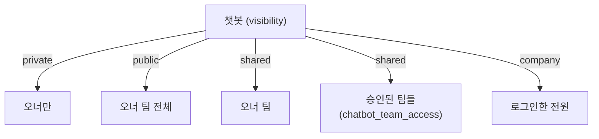
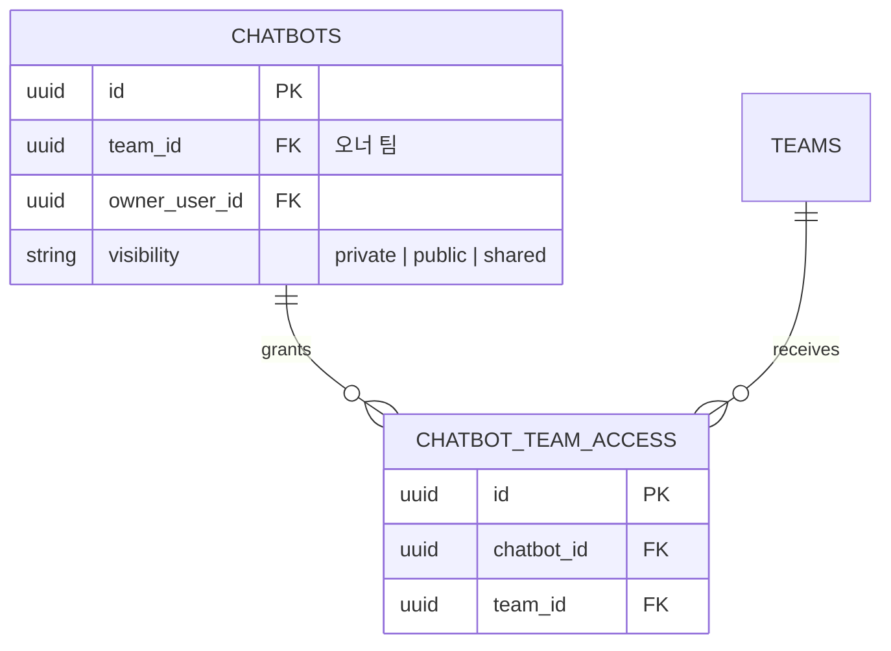

# 챗봇 교차팀 공유 (Cross-Team Sharing)

> **✅ 실제 구현 (2026-10-26 기준) — 아래 §1~ 본문은 초기 설계안에서 출발해 최종 동작에 맞게 고쳐 왔습니다. 어긋나는 곳이 있으면 이 박스가 기준입니다.**
>
> **가시성 4값**: `private`(소유자만) / `public`(소유자 **팀 전체**, 교차팀 아님) / `shared`(소유자 팀 + 추가 승인 팀) / `company`(전사 공개 — 로그인한 누구나, 최종관리자만 설정, 2026-09-04). enum 에 `shared` **추가됨**(`schema_upgrade` 가 `ALTER TYPE chatbotvisibility ADD VALUE 'shared'`).
>
> - **추가 팀 지정**: 전용 `/shares` 엔드포인트 **없음**. `POST`·`PATCH /chatbots` 의 인라인 필드 **`extra_team_ids`** 로 처리(`visibility != shared` 면 백엔드가 자동 청소). 팀 목록은 `GET /team/list`(TeamLite, invite_code 비노출).
> - **저장**: `chatbot_team_access`(chatbot_id, team_id, created_at — `granted_by` 컬럼 없음).
> - **접근 판정**: `chatbot_service._user_can_access` — 소유자 / super_admin(전역 계정) / `company` / 같은 팀(비-private) / 타 팀은 shared 이고 `chatbot_team_access` 에 등록된 경우.
> - **교차팀 근거 범위(2026-10-26 변경)**: 소유 팀이 아닌 사용자(super_admin 제외)에게도 챗봇이 고른 근거 범위(`rag_scope`)가 적용된다. 다만 소유 팀 사용자보다 **좁게** 적용된다.
>     - `team_all`(우리 팀 문서 전체) → 소유 팀의 **팀 공개(`scope=team`) 문서 중 처리 완료(`ready`)인 것만**. 연결 문서는 합치지 않는다(같은 팀 `team_all` 도 연결 문서를 쓰지 않으므로 일관). 개인 문서는 연결돼 있어도 나가지 않는다.
>     - `owner_visible`(내가 올린 문서 전체) → **소유자가 직접 올린 문서(개인·팀 모두, `ready`, 챗봇 팀 소속)만**. 다른 팀원이 소유자에게 공유한 문서, 다른 팀원이 올린 팀 문서는 나가지 않는다(같은 팀 사용자의 `owner_visible` 은 종전대로 `_visible_doc_ids(owner)` = 팀 문서 + 소유자 개인 + 소유자에게 공유된 문서).
>     - `linked_only`(고른 문서만) → 연결 문서(`chatbot_documents`)만. 변경 없음.
>     - 전역 봇(`chatbot.team_id` 가 NULL)은 스코프와 무관하게 연결 문서만. super_admin 은 종전처럼 소유 팀 규칙을 그대로 탄다(2026-07-06).
>     - 교차팀에는 `None`(같은 팀 기본 로직)을 돌려주지 않고 문서 id 목록을 돌려준다. `None` 은 호출측마다 해석이 달라서다 — RAG 검색(`chatbot_rag`)은 챗봇 팀 기준(팀 문서 + 요청자 개인·공유 문서), 문서 목록 답(`_document_inventory`)은 요청자 팀 기준.
>     - 같은 규칙을 쓰는 곳: RAG 검색(`chatbot_rag`), 카드 '문서 N' 칩(`rag_doc_count`), "어떤 문서를 볼 수 있어?" 목록 답(`_document_inventory`), 답변 재사용(`answer_cache`).
> - **예전 규칙(~2026-10-26, 폐기)**: `resolve_rag_scope_doc_ids` 가 요청자 팀 ≠ 소유 팀이면 스코프를 무시하고 연결 문서만 돌려줬다("공유는 챗봇 + 오너가 붙인 문서까지"). 그래서 `team_all` 에 연결 문서 0개인 총무팀 챗봇이 다른 팀에는 근거 0개로 "확인할 수 없습니다"만 답했다(10/21~10/26, 다른 팀 도시락 질문 수백 건).
> - **원문 열람**: 다른 팀 사용자도 쓸 수 있는 챗봇의 **근거 범위 안 문서**면 원문 뷰어로 열고 내려받을 수 있다 — 답에 인용된 문서만이 아니다(모델이 받는 범위 안 파일명 목록의 이름으로도 열린다). 판정은 `documents/router.py::_chatbot_grants_read` 로 `/by-id`·`/by-name`·`/rendered`·`/sheets`·`/download` 공통. 범위 밖 다른 팀 문서는 계속 404.
> - **운영 지침**: 다른 팀에 보이면 안 되는 자료는 **개인 문서**로 올리거나, 근거 범위를 **고른 문서만**(`linked_only`)으로 둔다. 개인 문서로 막는 방법은 `team_all` 에서만 통한다 — `owner_visible` 은 소유자가 직접 올린 개인 문서까지 공개받은 팀의 답에 쓰인다.
> - UI: 생성/편집 페이지 모두 팀 multi-select + "전체 팀(조직 전체)" 선택 토글. 가시성이 `shared`·`company` 이고 근거 범위가 `team_all`·`owner_visible` 이면 `CrossTeamRagNotice` 안내 박스가 뜬다(판정 `features/chatbots/crossTeamScope.ts`, §8).

## 1. 왜 필요한가

- 인사팀 "인사 규정 봇"을 영업팀도 그대로 쓰고 싶다.
- 다만 **소유 팀의 문서 화면(`/documents` 목록)은 열어 주지 않는다** — 다른 팀에 허용하는 것은 챗봇을 통한 질의응답과 근거 범위 안 문서의 원문 보기·다운로드까지다. 근거 범위 안 문서는 파일명 목록이 모델에 가고(문서 목록 질문에 답할 수 있음), 그 이름으로 원문을 열 수 있다. 막는 것은 `/documents` 화면의 목록·폴더 탐색과 범위 밖 문서다.
- 전사 공개(아무 팀이나 사용)를 기본값으로 두지 않는다 — 꼭 사용해야 할 팀만 오너가 **승인**해 공유한다.

## 2. 가시성 규칙 (단순화)

| visibility | 사용 가능한 사용자 |
| ---------- | ----------------- |
| `private` | 오너(`owner_user_id`)만 |
| `public` | **오너 팀 전체**(교차팀 아님) |
| `shared` | **오너 팀 + `chatbot_team_access` 에 등록된 추가 팀**의 구성원 |
| `company` | 로그인한 **누구나**(전사 공개 — 최종관리자만 설정, 2026-09-04) |

교차팀 공유는 `shared`(와 최종관리자 전용 `company`)가 담당하며 `public` 은 오너 팀 한정입니다(상단 진실 박스 참조). super_admin 은 가시성과 무관하게 모든 챗봇을 쓸 수 있습니다(2026-07-06).



- 오너 팀은 **항상** 접근 가능(묵시). 별도 레코드 필요 없음.
- `shared` 인데 승인 리스트가 비어 있으면 `public` 과 같다(오너 팀만 사용 가능).
- 타 팀 추가/제거는 오너 또는 오너 팀의 `team_admin` 이상만 수행 가능.

호환성: 기존 `public` 값은 그대로 유지. enum 에는 `shared`·`company` 를 추가했다(`schema_upgrade`).

## 3. 데이터 모델

### 3.1 신규 테이블 — `chatbot_team_access`

```
chatbot_team_access
┌────────────┬──────────────────────────────────────────┐
│ id │ UUID PK │
│ chatbot_id │ UUID FK chatbots.id ON DELETE CASCADE │
│ team_id │ UUID FK teams.id ON DELETE CASCADE │
│ created_at │ TIMESTAMP │
│ UNIQUE (chatbot_id, team_id) │
└────────────┴──────────────────────────────────────────┘
```

- `visibility=shared` 일 때만 의미 있음. 그 외 가시성이면 백엔드가 레코드를 자동 청소(`replace_extra_team_access(…, [])`).
- 실제 컬럼은 `id`(PK)·`chatbot_id`(FK CASCADE)·`team_id`(FK CASCADE)·`created_at` 와 `UNIQUE(chatbot_id, team_id)` 뿐이다(`granted_by` 미구현).
- `chatbot` 삭제 시 cascade. 팀 삭제 시에도 cascade 후 공유 자동 해제.

### 3.2 ERD 조각



## 4. 권한 매트릭스

| 작업 | 오너 | 오너 팀의 team_admin | 승인된 타 팀 팀원 | 미승인 타 팀 | super_admin |
| ---- | :---: | :---: | :---: | :---: | :---: |
| 대화 시작 (`shared`) | | | | ❌ | |
| 대화 시작 (`public`) | | | ❌ | ❌ | |
| 대화 시작 (`private`) | | ❌ | ❌ | ❌ | |
| 프롬프트/문서/도구 편집 | | | ❌ | ❌ | |
| `public`↔`private` 전환 | | | ❌ | ❌ | |
| 승인 팀 추가/제거 | | | ❌ | ❌ | |
| 근거 범위 안 문서의 원문 보기·원본 다운로드 | | | | ❌ | |
| 소유 팀 문서 화면(`/documents` 목록) · 근거 범위 밖 문서 열람 | | | ❌ | ❌ | |

(빈 칸 = 허용)

핵심 — **챗봇 응답과 근거 범위 안 문서의 원문 보기는 허용, 소유 팀 문서 화면(`/documents` 목록)과 범위 밖 문서는 허용하지 않음**(2026-10-26).

## 5. 권한 체크 로직

`services/chatbot_service.py::_user_can_access()` (래퍼 `get_for_use()` 에서 호출):

```python
if chatbot.owner_user_id == user.id:
 return True                                  # 소유자는 항상
if user.role == UserRole.super_admin:
 return True                                  # 전역 계정 (2026-07-06)
if chatbot.visibility == ChatbotVisibility.company:
 return True                                  # 전사 공개 (2026-09-04)
if chatbot.team_id == user.team_id:
 # 같은 팀: private 면 소유자만, 그 외(public/shared)는 팀원도 OK
 return chatbot.visibility != ChatbotVisibility.private
# 다른 팀: shared 인 경우 chatbot_team_access 에 내 팀이 등록되어 있어야 함
if chatbot.visibility != ChatbotVisibility.shared:
 return False                                 # public 은 타 팀에 절대 열리지 않음
return await _team_is_granted(db, chatbot.id, user.team_id)
```

내 접근 가능 챗봇 목록(`GET /chatbots` → `chatbot_service.list_visible`):

```sql
WITH me AS (SELECT :user_id::uuid AS uid, :team_id::uuid AS tid)
SELECT c.*
 FROM chatbots c, me
 WHERE c.owner_user_id = me.uid
 OR (c.visibility != 'private' AND c.team_id = me.tid)
 OR (c.visibility = 'shared'
 AND EXISTS (
 SELECT 1 FROM chatbot_team_access a
 WHERE a.chatbot_id = c.id AND a.team_id = me.tid
 ))
 ORDER BY c.updated_at DESC;
```

## 6. RAG 스코프와의 상호작용

2026-10-26 부터 근거 범위(`rag_scope`)는 공개받은 다른 팀에도 적용된다. 다만 다른 팀에는 더 좁게 적용된다(상단 진실 박스 참조). 실제로 받는 근거는 다음과 같다. "처리 완료" 는 `status=ready`.

| 근거 범위 (화면 이름) | 소유 팀 사용자 | 공개받은 다른 팀 사용자 |
| --- | --- | --- |
| `linked_only` (고른 문서만) | 연결 문서만 | 연결 문서만 |
| `team_all` (우리 팀 문서 전체) | 팀 문서 + 본인 개인 문서 + 본인에게 공유된 문서 | 소유 팀의 **팀 공개 문서(처리 완료)만** — 연결 문서·개인 문서 없음 |
| `owner_visible` (내가 올린 문서 전체) | 팀 문서 + 소유자 개인 문서 + 소유자에게 공유된 문서 | **소유자가 직접 올린 문서(개인·팀, 처리 완료)만** — 공유받은 문서·다른 팀원의 팀 문서 없음 |

- `linked_only` — 오너가 명시적으로 연결한 문서만. 다른 팀에 나가는 문서를 하나하나 통제하려면 이 값을 쓴다.
- `team_all` — 소유 팀이 팀 공개로 올린 문서가 모두 다른 팀의 답에 인용될 수 있다. 다른 팀에 보이면 안 되는 자료는 개인 문서로 올린다.
- `owner_visible` — 소유자가 직접 올린 개인 문서까지 다른 팀의 답에 인용될 수 있다. 개인 문서로 올려도 막히지 않는다. 다른 팀원의 문서는 나가지 않는다.
- 저장을 막지는 않는다. 다른 팀에 공개하면서 자동 범위를 고르면 만들기/편집 화면에 안내 문구만 뜬다(§8 — 초기 설계의 "경고 후 명시적으로 덮어써야 저장" 은 구현하지 않았다).
- 원문 열람도 같은 범위를 따른다 — 다른 팀 사용자는 근거 범위 안 문서(인용 여부와 무관)를 원문 뷰어로 열고 내려받을 수 있고, 범위 밖 문서는 404.

## 7. API

| 메서드 | 경로 | 설명 |
| ------ | ---- | ---- |
| `GET` | `/chatbots` | 내가 접근 가능한 목록(오너 + 오너 팀 public/shared + 승인 받은 shared) |
| `POST` / `PATCH` | `/chatbots` · `/chatbots/{id}` | 본문 인라인 필드 `extra_team_ids: [team_uuid...]` 로 공유 팀 지정·교체(`visibility != shared` 면 백엔드가 자동 비움). 전용 `/shares` 엔드포인트는 **없음** |
| `GET` | `/team/list` | 공유 팀 선택용 팀 목록(`TeamLite`, `invite_code` 비노출) |

요청 예:

```http
PATCH /chatbots/{id}
{ "visibility": "shared", "extra_team_ids": ["<team-uuid-1>", "<team-uuid-2>"] }
```

`visibility` 가 `shared` 가 아니면 `extra_team_ids` 를 보내더라도 백엔드가 무시·청소합니다(전용 권한 오류 대신 정책적 자동 정리).

## 8. UI 변경

- `/chatbots/[id]` 편집 "기본" 섹션(탭 아님 — 단일 스크롤 폼):
 - 가시성은 **3값 라디오 카드** `VisibilityChooser`(`🔒 나만` / `👥 우리 팀` / `🌐 선택 팀`, 최종관리자에게는 `🏢 전사 공개` 까지 4값) — 표시 명칭·아이콘은 `features/chatbots/labels.ts` 단일 소스.
 - `선택 팀`(=`shared`) 선택 시 하단에 회사→팀 트리+검색 `TeamPicker`(`features/chatbots/TeamPicker.tsx`)가 펼쳐진다. 고른 팀은 별도 호출이 아니라 **저장(`PATCH /chatbots/{id}`) 본문의 `extra_team_ids`** 로 전달된다. **전용 `/shares` 엔드포인트는 없다.**
- 생성(`/chatbots`)·편집(`/chatbots/[id]`) 페이지가 `VisibilityChooser`·`TeamPicker` 를 공유한다.
- `/chatbots` 목록 뱃지: 가시성 태그는 `labels.ts` 의 `visibilityTag()`(`🔒 나만` / `👥 우리 팀` / `🌐 선택 팀` / `🏢 전사 공개`)로 통일.
- **교차팀 근거 범위 안내(2026-10-26)**: `CrossTeamRagNotice`(`features/chatbots/CrossTeamRagNotice.tsx`) — 판정은 순수 함수 `crossTeamRagNotice()`(`features/chatbots/crossTeamScope.ts`). `use_rag` 이고 가시성이 `shared`·`company`, 근거 범위가 `team_all`·`owner_visible` 일 때만 그린다. 편집 화면은 근거 범위 카드 아래, 만들기 화면은 근거 범위 단계와 공개 범위 단계 양쪽에 둔다. 문구:
    - `team_all`: "이 챗봇을 쓰는 다른 팀도 우리 팀 문서 전체로 답을 받아요. 개인 문서는 포함되지 않아요. 다른 팀에 보이면 안 되는 자료는 개인 문서로 올려 주세요."
    - `owner_visible`: "이 챗봇을 쓰는 다른 팀도 내가 올린 문서 전체(개인 문서 포함)로 답을 받아요."

## 9. 감사 · 책임 추적

- `chatbot_team_access` 에는 `granted_by` 컬럼이 없어 "누가 승인했는지"는 별도로 기록되지 않는다(향후 컬럼 추가 시 추적 가능).
- `Conversation.chatbot_id`로 "A팀 챗봇을 B팀원이 사용"한 대화를 사후 조회 가능.
- `/team/audit/conversations` 는 본인 팀 소속 사용자의 대화만 반환 → 오너 팀이 타 팀 구성원의 대화 전체를 들여다볼 수는 없음(개인정보 경계). 다만 챗봇별 감사(`/team/audit/chatbots`, 2026-09-04)는 자기 팀의 팀 공개(public/shared) 챗봇에서 오간 대화를 타 팀 질문자 것까지 보여 준다([api.md](./api.md) 참조).

## 10. 마이그레이션 단계

1. `chatbot_team_access` 테이블 신설(cascade FK 포함).
2. 서비스 계층(`chatbot_service`, `chatbot_rag`)에 팀 접근 체크 로직 주입.
3. 기존 `public` 챗봇은 변경 없이 **오너 팀 전용**으로 계속 동작.
4. 프론트 공유 UI 는 별도 `/chatbots/[id]/shares` 화면/엔드포인트가 **아니라**, 편집·생성 폼의 `VisibilityChooser`+`TeamPicker` 로 처리하고 저장 시 `extra_team_ids` 로 전달한다(§8 및 상단 진실 박스 참조 — 전용 `/shares` 엔드포인트 없음).
5. (선택) 감사 화면에 "공유 챗봇 대화" 필터 제공.

## 11. 오픈 이슈

- **LLM 비용 귀속** — A팀 챗봇을 B팀이 쓰면 비용은 누구 부담? → `conversations.owner_team_id` 컬럼으로 집계 기준 분리 검토.
- **Rate-limit** — 챗봇/팀/사용자 중 어디서 제한할지 결정.
- **지식 차단(mute)** — 공유 받은 팀이 특정 문서를 답변에서 배제하고 싶은 경우 `chatbot_documents.muted_team_ids` 등 후속 확장.
- **승인 취소 시** — 진행 중인 대화에 어떻게 반영할지(즉시 차단 vs. 새 메시지부터 차단) 정책 결정.
