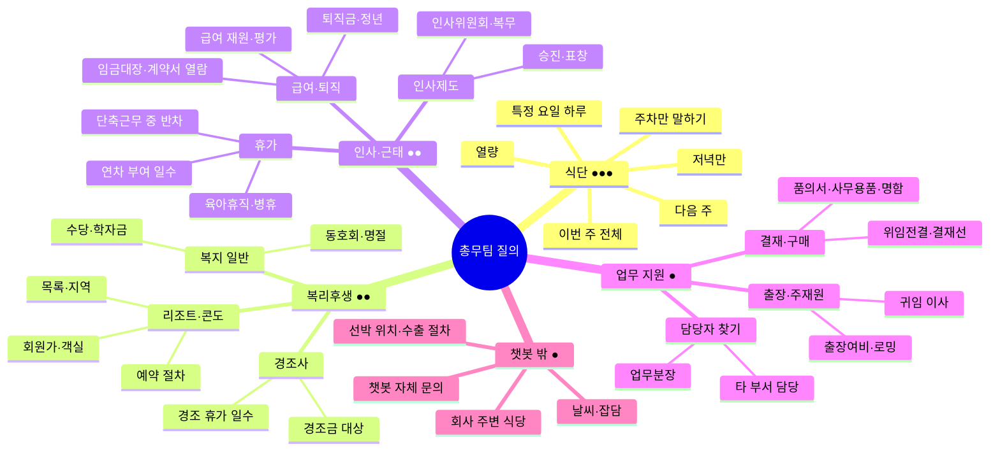
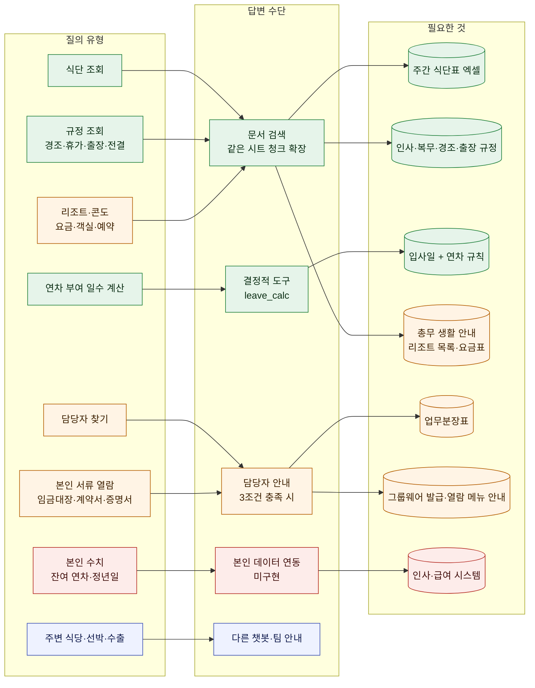

# 총무팀 질의 온톨로지

총무팀 챗봇에 실제로 들어온 질문을 개념·관계로 정리한 지도다. 어떤 질문이 오고, 답하려면 무엇이 필요하며, 무엇이
비어 있는지를 한 장에 둔다. 문서 보강·데이터 연동·프롬프트 규칙의 우선순위를 정할 때의 기준점이고, 새 총무 주제가
생기면 여기에 먼저 자리를 잡는다.

- **근거** — 2026-10-26~11-25 총무팀 챗봇의 검색 계획 로그(요청마다 남는 검색어 한 줄) 전수. 주제 분류는 검색어
  기준이라 원문 질문과 조금 다를 수 있다. 질문 원문·사용자·건수는 싣지 않고 비중만 단계로 적는다(공개 문서).
- **비중 표기** — ●●● 대부분 / ●● 꾸준히 / ● 가끔.

## 1. 개념 계층 — 무엇을 묻는가

질문 열에 여덟이 넘게 식단이다. 나머지는 폭이 넓고 건수가 얕다.

## 2. 관계 — 질의 유형 → 답변 수단 → 필요한 것

색은 **지금 상태**다. 초록=문서·도구로 답한다, 주황=문서가 있어도 빈 칸이 있다, 빨강=개인 데이터 연동이 있어야
한다, 파랑=다른 챗봇·팀으로 보낸다.

## 3. 개체와 속성 — 답이 갈리는 축

| 개체 | 속성 | 실제 질문에서 드러난 것 |
| --- | --- | --- |
| **질의** | 의도(조회·계산·절차·담당자), 시간 범위, 끼니, 대상(본인·가족) | 식단 질문의 절반 이상이 **특정 요일 하루**, 그다음이 주간 전체와 "○월 ○주차"처럼 **주차만** 말하는 질문이다 |
| **식단** | 주차, 요일·날짜, 끼니, 메인 A/B(택1), 총열량 | 주차만 온 질문은 그 주 전체로 답한다. 다음 주 질문은 파일이 올라온 뒤에만 답할 수 있다 |
| **가족 관계** | 본인·배우자·부모·조부모·형제자매·배우자의 형제자매 | 경조 질문은 거의 전부 "이 관계도 해당되나"다 — 규정의 관계 표를 그대로 찾아야 한다 |
| **근무 형태** | 일반·단축근무·주재원 | 단축근무 중 반차 시간, 주재원 귀임 이사·자녀 교육비처럼 **형태별 예외**를 묻는다 |
| **리조트·콘도** | 지역, 객실, 회원가, 예약 절차 | 같은 대화에서 지역→객실→요금→절차로 이어 묻는다. 요금·객실이 문서에 없으면 질문이 반복된다 |
| **연차 규칙** | 입사일, 근속 연수, 직급 | 부여 일수는 `leave_calc` 가 계산한다. 잔여 일수·연차 계획은 본인 데이터라 답할 수 없다 |
| **담당** | 업무, 부서, 공용 메일함 | 총무 업무뿐 아니라 **타 부서 업무의 담당 부서**를 묻는다(시설·안전보건·사회공헌 등) |
| **문서** | 소유 팀, 공개 범위, 상태, 등록 주체 | "이 파일은 누가 올리나", "나는 왜 못 보나"처럼 출처·권한 자체를 묻기도 한다 |

## 4. 온톨로지가 묶어 두는 답변 규칙

| 규칙 | 적용 가지 |
| --- | --- |
| '없음'과 '검색에 안 걸림'은 다르다 — 발췌에 없는 칸을 채우지 않는다 | 식단, 리조트·콘도 요금 |
| 담당자 문의 안내는 ① 챗봇 주제 ② 문서에 없음 ③ 계산으로 답 불가, 셋 다 맞을 때만 | 전 가지 |
| 개인 수치(잔여 연차·정년일·급여)는 규정의 기준만 답하고 본인 값은 지어내지 않는다 | 인사·근태 |
| 가족 관계·근무 형태가 규정 표에 없으면 "표에 없다"고 답하고 유추하지 않는다 | 경조사, 휴가 |
| 다른 챗봇·팀 주제면 첫 줄에 그곳을 안내한다 | 챗봇 밖 |
| 짧은 후속 질문("표로", "A와 B")은 직전 질문과 합쳐 검색한다 | 식단, 리조트·콘도 |
| 검색 자체가 실패하면 "없다"가 아니라 일시 오류로 안내한다 | 전 가지 |

## 5. 비어 있는 자리 — 다음에 채울 것

| 가지 | 지금 | 채우려면 |
| --- | --- | --- |
| 리조트·콘도 요금·객실 | 목록·절차는 있고 요금·객실 표가 약해 같은 질문이 반복된다 | 지역·객실·회원가를 표 한 장으로 등록 |
| 담당자 찾기 | 업무분장표가 없어 담당 부서를 답하지 못한다 | 총무 업무분장표 + 자주 묻는 타 부서 창구 표 |
| 본인 서류 열람·발급 | 임금대장·근로계약서·증명서 경로 안내가 없다 | 그룹웨어 메뉴 경로 안내 문서 1장 |
| 본인 수치 | 잔여 연차·연차 계획·정년일은 문서로 답할 수 없다 | 인사 시스템 조회 연동(본인 확인 포함) |
| 결재·구매 실무 | 전결 규정은 있고 품의서 작성법·사무용품 신청 경로가 없다 | 품의서 예시·신청 사이트 안내 |
| 식단 다음 주 | 파일 등록 전에는 답할 수 없다 | 다음 주 파일 등록 시점을 답변에 표시 |
| 회사 주변 식당 | 문서에 없는 주제인데 꾸준히 온다 | 웹 검색 도구로 넘기거나 범위 밖으로 안내 |

## 6. 코드와의 연결

- 문서 범위·공유 규칙 — [챗봇 공유](chatbot_sharing.md), [챗봇](chatbot.md)
- 검색·같은 시트 청크 확장·답변 재사용 — [문서 RAG](document_rag.md), [RAG 개선 노트](rag-improvements.md)
- 결정적 도구(`leave_calc`)·도구 목록 — [도구](tools.md)
- 답변 원칙·다른 챗봇 안내·담당자 안내 조건 — `features/chat/prompt_builder.py`
